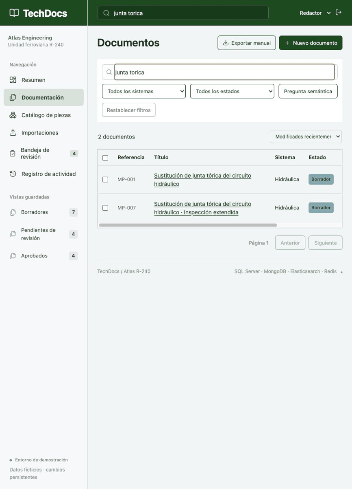
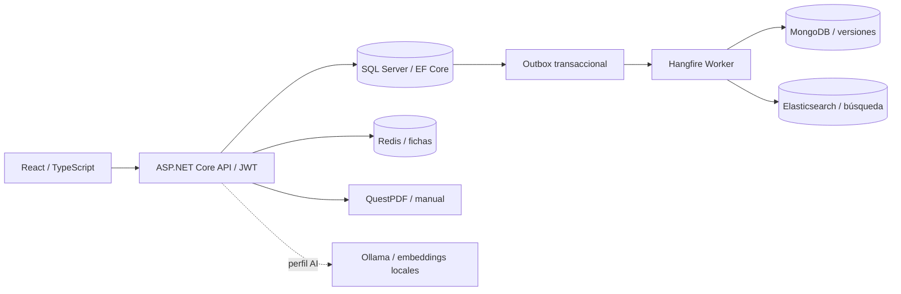

# TechDocs

[](https://github.com/PedroFlores199/TechDocs/actions/workflows/ci.yml)

**Gestor de documentación técnica de una unidad ferroviaria ficticia.** Centraliza piezas y procedimientos, conserva sus versiones y exige revisión y aprobación por personas con roles distintos.



[Ver el flujo de aprobación en vídeo](docs/approval.mp4) · [Captura del buscador](docs/search.jpg)

| En 60 segundos | Qué puedes comprobar |
| --- | --- |
| Buscar | «junta torica» encuentra contenido con acentos; Elasticsearch añade sinónimos y tolerancia a errores. |
| Trabajar | Editor por bloques, versiones, comparación visual y referencias a piezas. |
| Aprobar | Redactor → Revisor → Aprobador; los permisos se comprueban en la API. |
| Importar | Excel/XML en segundo plano, limpieza, duplicados e informe por fila. |
| Trazar | Un cambio en una pieza crea tareas para sus documentos afectados. |
| Entregar | Manual PDF con portada, índice, versiones aprobadas y huellas SHA-256. |

**Stack:** C# 12 · .NET 10 LTS · ASP.NET Core · EF Core · SQL Server · MongoDB · Elasticsearch · Redis · Hangfire · React/TypeScript.

## Probarlo

```bash
git clone https://github.com/PedroFlores199/TechDocs.git
cd TechDocs
docker compose up --build -d
```

Abre [localhost:5080](http://localhost:5080). El primer arranque descarga las imágenes y prepara el catálogo. No requiere servicios de pago ni claves externas. Los botones de acceso abren cuatro cuentas de demostración. Contraseña común: `Demo1234!`; correos: `redactor@techdocs.demo`, `revisor@techdocs.demo`, `aprobador@techdocs.demo`, `lector@techdocs.demo`.

Recorrido: entra como Redactor, busca una junta, abre su procedimiento y envíalo a revisión. Cambia el perfil en la barra superior, valida como Revisor y aprueba como Aprobador. Después modifica la pieza desde el catálogo y consulta las tareas de impacto. Importa [el Excel de ejemplo](samples/catalogo-ejemplo.xlsx): contiene dos filas válidas, un duplicado y un sistema desconocido.

En macOS, SQL Server se ejecuta como `linux/amd64` mediante emulación. Microsoft no ofrece soporte oficial para SQL Server en ARM. Para probar sin Docker: SDK .NET 10 y Node 22, después `./scripts/run-local.sh`. Este modo utiliza SQLite y archivos JSON; la búsqueda fuzzy, MongoDB y Redis se prueban con el despliegue completo. [Compatibilidad de SQL Server](https://learn.microsoft.com/en-us/sql/linux/containers/deploy).

## Cómo está organizado



| Carpeta | Responsabilidad |
| --- | --- |
| `src/TechDocs.Domain` | Entidades, estados y contenido por bloques. |
| `src/TechDocs.Application` | Contratos, validación y reglas de aprobación. |
| `src/TechDocs.Infrastructure` | Persistencia, importación, búsqueda, outbox y PDF. |
| `src/TechDocs.Api` | Endpoints, JWT, roles, límites de peticiones y errores ProblemDetails. |
| `src/TechDocs.Worker` | Procesamiento persistente de Hangfire. |
| `web` | Interfaz React, filtros, editor y comparación. |
| `tests` | Pruebas de reglas, HTTP e integración con SQL Server real. |
| `tools` | Medición reproducible de 50.000 piezas. |

**Por qué tres almacenes:** SQL mantiene relaciones, permisos y transacciones; Mongo guarda el contenido variable de cada versión; Elasticsearch mantiene una proyección orientada a búsqueda. SQL y los mensajes de outbox se guardan juntos. El worker replica el contenido de forma idempotente y reintenta fallos; no se presupone una transacción distribuida. El panel informa de sincronizaciones pendientes.

## Calidad y decisiones

22 pruebas automáticas, incluida integración con Testcontainers/SQL Server. Comprueban separación de funciones, autenticación, acceso de solo lectura, edición concurrente, referencias inválidas, XML sin entidades externas, impacto, conservación de versiones, búsqueda y generación de PDF.

```bash
dotnet test
RUN_CONTAINER_TESTS=1 dotnet test
```

La segunda orden requiere Docker y ejecuta también la prueba con SQL Server. GitHub Actions compila, ejecuta todas las pruebas, construye el frontend y las imágenes de API y worker en cada push.

En el Mac de prueba, 50.000 piezas tardaron **6.612 ms con EF Core y 1.605 ms con SqlBulkCopy** (4,12×). Es una medición de persistencia aislada, no una promesa de rendimiento del ETL completo; los detalles y límites están en [los resultados](docs/benchmark-results.json). Para repetirla, configura `BENCHMARK_SQL` con una base vacía y ejecuta `dotnet run -c Release --project tools/TechDocs.Benchmarks`.

La API interactiva está en [/swagger](http://localhost:5080/swagger); salud en `/health/live` y `/health/ready`. [Arquitectura y modelo de datos](docs/architecture.md) · [Guion de entrevista](docs/interview.md) · [Validación y alcance](docs/validation.md).

## Funciones opcionales

Embeddings locales con citas de los pasos, sin enviar documentos a una API externa:

```bash
AI_ENABLED=true docker compose --profile ai up --build -d
```

El servicio `model-init` descarga `nomic-embed-text`. Tras terminar, consulta `/api/semantic/ask?question=como%20cambiar%20el%20filtro` con un JWT, o utiliza el buscador semántico de la interfaz. Recupera pasos existentes; no genera instrucciones de mantenimiento. La primera consulta crea los embeddings y tarda más.

`docker compose --profile observability up -d` añade Seq en [localhost:5341](http://localhost:5341). Serilog produce registros estructurados y OpenTelemetry instrumenta las peticiones HTTP.

## Alcance

Aplicación de portfolio para una demostración local: cuentas y contraseñas públicas deliberadas, puertos publicados solo en `127.0.0.1` y datos ficticios. El esquema se crea con `EnsureCreated`; una instalación con evolución de esquema requiere migraciones y gestión propia de usuarios y secretos. El orden del listado se aplica a la página visible. Las imágenes de bloques se conservan como enlaces HTTPS. No es documentación apta para mantenimiento real.

La interfaz reproduce la organización y los valores visuales de [Paperless-ngx](https://docs.paperless-ngx.com/), manteniendo marca, dominio e implementación propios. .NET 10 sustituye la propuesta inicial de .NET 8 por su [ciclo de soporte](https://dotnet.microsoft.com/en-us/platform/support/policy). [Licencias y atribuciones](NOTICE.md).
