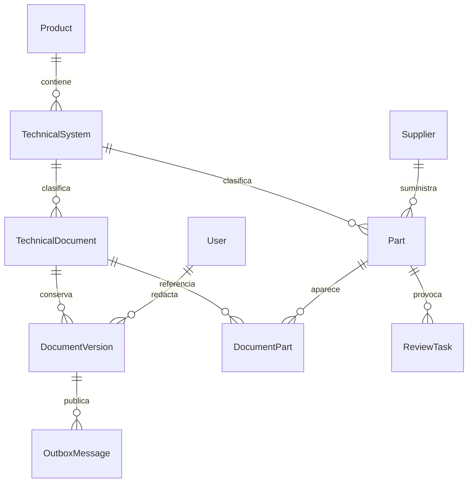

# Arquitectura y consistencia

La API depende de Application e Infrastructure. Domain no conoce EF Core, MongoDB ni HTTP. Las reglas de aprobación son funciones comprobables sin bases de datos.

Cada escritura documental crea metadatos SQL y un mensaje de outbox en la misma transacción de `SaveChanges`. El mensaje incluye el contenido, el título y las referencias de esa versión. Un fallo de Mongo o Elasticsearch no elimina la operación SQL; queda pendiente de réplica. El procesamiento sustituye por identificador, por lo que repetir un mensaje no duplica versiones. El worker reintenta y el aprobador puede reiniciar mensajes agotados mediante `/api/sync/retry`.

La búsqueda es eventualmente consistente. Solo se indexa la versión actual del documento. El contenido puede leerse desde un mensaje SQL pendiente si todavía no llegó a Mongo. Las fichas de piezas tienen caché Redis de cinco minutos e invalidación al modificar la pieza. Una modificación de pieza incrementa su revisión y crea una tarea por documento afectado y revisión; el índice único evita duplicaciones accidentales.

El control de concurrencia utiliza revisiones explícitas y tokens de EF Core. El cliente envía `expectedRevision`; un cliente desactualizado recibe 409. Redactor envía, Revisor valida y Aprobador aprueba; el autor no puede revisar/aprobar su propio trabajo. Una edición crea una versión nueva. El contenido histórico conserva su huella y no se sobrescribe.

Los archivos Excel tienen límite de tamaño comprimido/descomprimido y de filas. XML prohíbe DTD y resolución externa. Las filas válidas se cargan juntas en una transacción y los errores se guardan por número de fila. La importación es idempotente por estado de lote y por código único de pieza.

El modo local sustituye explícitamente las dependencias externas por SQLite y archivos; no pretende emular toda la semántica de Elasticsearch. El esquema inicial usa `EnsureCreated`: los repositorios no ofrecen actualización automática entre versiones de esquema.
